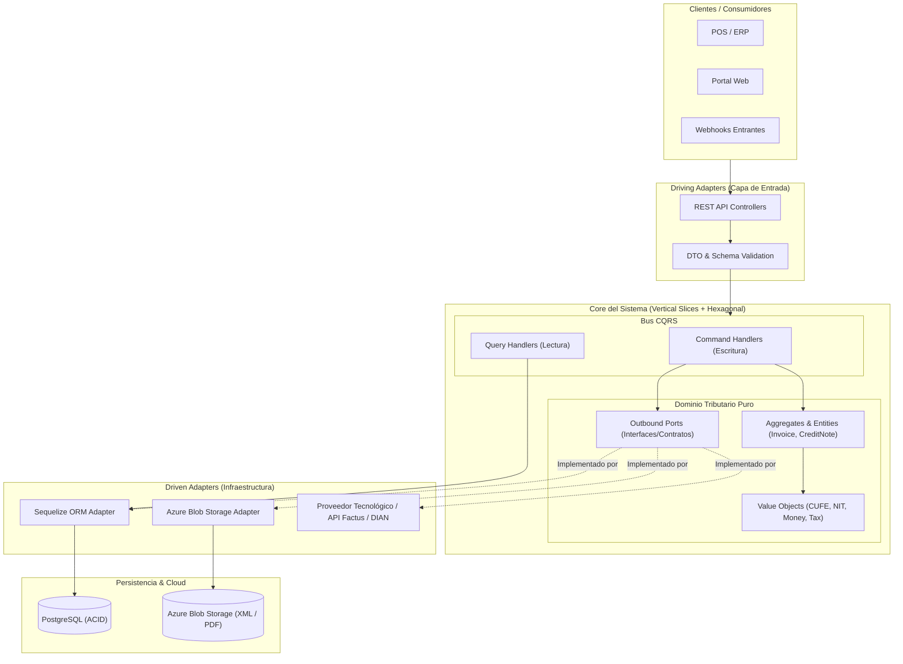
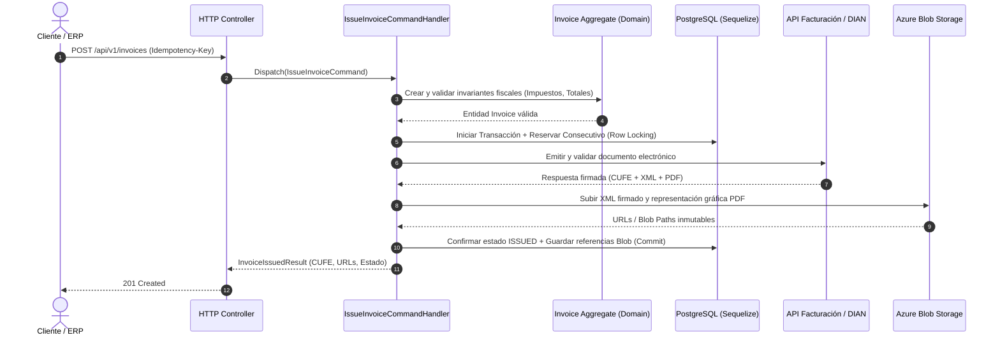

# 🧾 Factus — Core de Facturación Electrónica


**Factus** es una plataforma backend de **Facturación Electrónica** diseñada bajo estándares empresariales de alta cohesión, bajo acoplamiento, trazabilidad auditable y tolerancia a fallos. El sistema gestiona el ciclo de vida completo de documentos tributarios electrónicos (facturas de venta, notas crédito, notas débito, validación previa, firma criptográfica y almacenamiento inmutable de soportes XML/PDF).

---

## 🏛️ Filosofía y Diseño Arquitectónico

En lugar de una arquitectura en capas tradicional (propensa al acoplamiento y a convertirse en un *Big Ball of Mud*), **Factus** implementa una combinación pragmática de tres patrones de ingeniería de software modernos:

1. **Vertical Slice Architecture (VSA):** El sistema se organiza alrededor de **casos de uso del negocio (Features/Slices)** y no de capas técnicas horizontales. Cada *slice* encapsula todo lo necesario de principio a fin.
2. **Arquitectura Hexagonal (Ports & Adapters):** Dentro de cada *slice* y en el núcleo del dominio, las reglas fiscales y tributarias están 100% aisladas de frameworks externos, ORMs, proveedores cloud o APIs gubernamentales.
3. **CQRS (Command Query Responsibility Segregation):** Separación estricta entre las operaciones que mutan el estado fiscal (**Commands**) y las consultas optimizadas para lectura, reportes y tableros (**Queries**).

### Diagrama de Arquitectura de Alto Nivel



---

## 🧠 Decisiones de Arquitectura (ADR Summary)

### 1. ¿Por qué Vertical Slice + Arquitectura Hexagonal?
- **Alta Cohesión por Feature:** Modificar la emisión de una *Nota Crédito* no requiere navegar por 15 carpetas globales de `controllers/`, `services/` y `repositories/`. Todo vive dentro de su propio *slice* (`features/credit-notes/`).
- **Aislamiento del Dominio (Hexagonal):** El cálculo de impuestos, retenciones, numeración y estados del documento vive en el dominio sin depender de `Sequelize` ni del SDK de `Azure`. Si mañana cambiamos el ORM o el proveedor de almacenamiento, la lógica tributaria permanece intacta.

### 2. ¿Por qué CQRS en Facturación Electrónica?
La facturación electrónica tiene una asimetría natural entre escritura y lectura:
- **Write Side (Commands):** Emitir una factura exige validaciones estrictas de invariantes de negocio, control de concurrencia en folios/consecutivos, transacciones ACID en **PostgreSQL**, generación de XML/PDF, subida a **Azure Blob Storage** y comunicación con el ente validador.
- **Read Side (Queries):** Consultar listados de facturas, estados de cuenta o descargar enlaces de PDFs/XMLs no debe hidratar agregados complejos del dominio; ejecuta consultas planas y optimizadas directamente contra proyecciones o vistas en PostgreSQL.



---

## 🛠️ Stack Tecnológico

| Categoría | Tecnología | Propósito en el Proyecto |
| :--- | :--- | :--- |
| **Runtime & Lenguaje** | **Node.js + TypeScript / ESNext** | Tipado estático / ejecución asíncrona de alto rendimiento para I/O intensivo. |
| **Arquitectura Base** | **Hexagonal + Vertical Slice + CQRS** | Separación de responsabilidades, escalabilidad evolutiva y testabilidad aislada. |
| **Base de Datos Relacional** | **PostgreSQL** | Garantía transaccional **ACID**, bloqueos pesimistas/optimistas para numeración fiscal e integridad referencial. |
| **ORM & Migraciones** | **Sequelize** | Mapeo objeto-relacional en la capa de infraestructura, manejo de migraciones versionadas, *seeders* y *connection pooling*. |
| **Almacenamiento Cloud** | **Azure Blob Storage** | Almacenamiento seguro, escalable e inmutable de artefactos legales (**XML UBL 2.1**, **AttachedDocument**, **PDFs** de representación gráfica) mediante acceso con *SAS Tokens*. |
| **Integración Fiscal** | **API Factus / Estándar DIAN** | Emisión, validación previa, consulta de rangos de numeración y eventos RADIAN. |

---

## 📂 Estructura del Proyecto

El código combina **Vertical Slices** (en `features/`) con un núcleo compartido (`shared/`) que define los contratos base y adaptadores transversales:

```text
src/
├── config/                                # Variables de entorno validadas, configuración de Sequelize y Azure
├── shared/                                # Kernel compartido (Cross-Cutting Concerns)
│   ├── domain/                            # Clases base: AggregateRoot, Entity, ValueObject, DomainError
│   ├── application/                       # Contratos del Bus CQRS (ICommand, IQuery, ICommandHandler)
│   └── infrastructure/                    # Adaptadores globales
│       ├── persistence/
│       │   └── sequelize/                 # Instancia de Sequelize, modelos compartidos, migraciones, UnitOfWork
│       ├── storage/
│       │   └── azure-blob/                # AzureBlobStorageAdapter (implementa IFileStoragePort)
│       └── http/                          # Middlewares globales (Error Handler, Idempotency, Correlation-ID)
│
└── features/                              # 🚀 VERTICAL SLICES (Módulos de Negocio)
    ├── invoices/                          # Slice: Facturación de Venta
    │   ├── domain/                        # Entidad Invoice, Value Objects (CUFE, TaxTotal), Ports (IInvoiceRepository)
    │   ├── application/                   # Capa CQRS del Slice
    │   │   ├── commands/
    │   │   │   ├── issue-invoice/         # IssueInvoiceCommand + IssueInvoiceCommandHandler
    │   │   │   └── cancel-invoice/        # CancelInvoiceCommand + CancelInvoiceCommandHandler
    │   │   └── queries/
    │   │       ├── get-invoice-by-id/     # GetInvoiceByIdQuery + GetInvoiceByIdQueryHandler
    │   │       └── list-invoices/         # ListInvoicesQuery + Paginated Projection
    │   └── infrastructure/                # Driven & Driving Adapters del Slice
    │       ├── http/                      # InvoiceController, Routes, Request DTO Validators
    │       ├── persistence/               # SequelizeInvoiceRepository, InvoiceModel, Mappers (Domain <-> Persistence)
    │       └── providers/                 # FactusApiAdapter (implementa ElectronicInvoicingPort)
    │
    ├── credit-notes/                      # Slice: Notas Crédito
    │   ├── domain/
    │   ├── application/
    │   │   ├── commands/
    │   │   └── queries/
    │   └── infrastructure/
    │
    └── customers/                         # Slice: Gestión de Adquirentes / Clientes
        ├── domain/
        ├── application/
        └── infrastructure/
```

---

## 🔒 Atributos de Calidad (Estándares Senior)

1. **Idempotencia en Emisión Fiscal:** Evita la doble facturación ante reintentos de red mediante control de `Idempotency-Key` y restricciones únicas de negocio en PostgreSQL.
2. **Integridad de Consecutivos:** Uso de transacciones en Sequelize con aislamiento controlado para evitar saltos o colisiones en los rangos de numeración autorizados.
3. **Separación de Modelos (Domain Model vs. Persistence Model):** Los modelos de `Sequelize` nunca salen de la capa `infrastructure/persistence`. Se utilizan `Data Mappers` dedicados para transformar entre el modelo relacional y el Agregado de Dominio.
4. **Seguridad de Documentos en Azure Blob Storage:** Los contenedores de Azure son privados. La descarga de PDFs y XMLs se realiza mediante **SAS Tokens (Shared Access Signatures)** de corta duración firmados desde el backend.
5. **Trazabilidad & Auditoría:** Cada intento de emisión, payload enviado al proveedor fiscal y respuesta recibida queda registrado con un `Correlation-ID` único para auditoría técnica y contable.

---

## ⚙️ Variables de Entorno (`.env.example`)

```env
# Aplicación
NODE_ENV=development
PORT=3000
LOG_LEVEL=info

# Base de Datos (PostgreSQL + Sequelize)
DB_HOST=localhost
DB_PORT=5432
DB_NAME=factus_db
DB_USER=postgres
DB_PASSWORD=your_secure_password
DB_POOL_MAX=20
DB_POOL_MIN=5
DB_SSL=false

# Almacenamiento Cloud (Azure Blob Storage)
AZURE_STORAGE_CONNECTION_STRING=DefaultEndpointsProtocol=https;AccountName=...;AccountKey=...;EndpointSuffix=core.windows.net
AZURE_STORAGE_CONTAINER_INVOICES=electronic-invoices
AZURE_SAS_EXPIRATION_MINUTES=15

# Integración Proveedor Facturación Electrónica (Factus API)
FACTUS_API_BASE_URL=https://api-sandbox.factus.com.co
FACTUS_CLIENT_ID=your_client_id
FACTUS_CLIENT_SECRET=your_client_secret
FACTUS_USERNAME=your_username
FACTUS_PASSWORD=your_password
```

---

## 🚀 Instalación y Ejecución Local

### Prerrequisitos
- **Node.js** >= 20.x
- **PostgreSQL** >= 15.x
- Cuenta de **Azure Storage** (o emulador local **Azurite** para desarrollo)

### Pasos de inicio

1. **Clonar el repositorio:**
   ```bash
   git clone git@github.com:dbritto/Factus_facturacion_electronica.git
   cd Factus_facturacion_electronica
   ```

2. **Instalar dependencias:**
   ```bash
   npm install
   ```

3. **Configurar variables de entorno:**
   ```bash
   cp .env.example .env
   ```

4. **Ejecutar migraciones y seeders de Sequelize:**
   ```bash
   npx sequelize-cli db:migrate
   npx sequelize-cli db:seed:all
   ```

5. **Iniciar el servidor en modo desarrollo:**
   ```bash
   npm run dev
   ```

---

## 🧪 Estrategia de Testing

- **Unit Tests (Dominio & Handlers):** Pruebas rápidas y sin base de datos sobre entidades, cálculos de impuestos, Value Objects y Command Handlers usando *In-Memory Ports / Mocks*.
- **Integration Tests (Adaptadores):** Pruebas de repositorios Sequelize contra PostgreSQL y adaptador de Azure Blob Storage contra *Azurite*.
- **E2E Tests (Slices Completos):** Pruebas de contrato sobre los endpoints HTTP validando el flujo completo de cada *Vertical Slice*.

```bash
# Ejecutar pruebas unitarias
npm run test:unit

# Ejecutar pruebas de integración
npm run test:integration

# Cobertura de código
npm run test:cov
```

---

## 🌿 Flujo de Trabajo y Convenciones (Git)

El proyecto utiliza **Conventional Commits** para mantener un historial semántico y trazable:
- `feat(invoices): add issue invoice command handler and azure xml upload`
- `fix(credit-notes): prevent duplicate consecutive numbering on retry`
- `refactor(shared): extract unit of work interface for sequelize transactions`
- `docs(readme): update architectural diagrams and env variables`

---

## 👤 Autor

**Daniel Britto** — [@dbritto](https://github.com/dbritto)